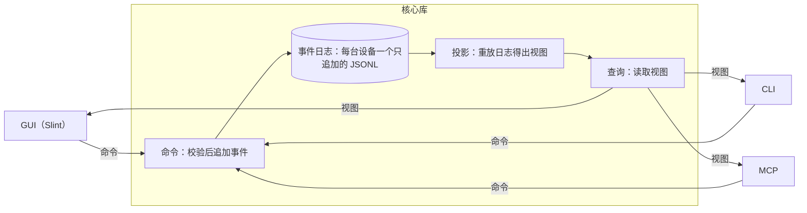

# 个人 Todo 系统设计文档

Oct 30, 2026 · @Admin Json

## 定位

**一句话定义：以“身份”组织、以“现在该做哪一件”为唯一入口，把杂事、项目 DAG 和习惯统一调度，并通过周复盘帮助用户了解自己的个人系统。**

目标用户只有一个：作者本人（学生，即将实习）。所有取舍都以“我自己每天愿不愿意用”为准，不为假想用户妥协。

文中标注 **\[建议\]** 的地方是我的判断而非你已确认的决定，请逐条审视，不同意就直接改。

### 设计原则

1. **零额外输入**：分析数据只来自日常使用产生的事件，绝不为了统计让用户多填一项。记录负担是自我追踪类工具被放弃的首要原因。
2. **不惩罚**：没有逾期标红、没有断链清零、放弃不算失败。断掉的连续记录会让人直接放弃整个行为。
3. **一次只推荐一件事**：解决“清单很长却不知从何开始”，降低启动门槛。
4. **形态与身份正交**：“为谁做”和“怎么组织”是两个独立维度，不混在一起。
5. **历史不可篡改**：所有变化以事件追加记录，可回溯、可撤销、可审计（类 git）。
6. **人是最终决策者**：AI 和启发式只提议，写入计划需要用户确认。
7. **指标服务于自我了解，而不是被刷高**：避免 reward hacking。

## 核心概念模型

每个事项在两个正交维度上各取一个值：**身份**（为谁、为什么）和**形态**（长什么样）。“记单词”不再同时属于两个类别，而是“学习 × 习惯”这一格。

| 身份 \\ 形态 | 杂事 | 项目节点 | 习惯 |
| --- | --- | --- | --- |
| 工作 | 回一封邮件 | 上级布置任务拆出的步骤 | 每周写周报 |
| 生活 | 交电费 | 搬家 | 早睡、写日记 |
| 学习 | 还图书馆的书 | 做一个 Rust 项目 | 记单词 |

### 实体

- **身份（Identity）**：默认工作、生活、学习，可增删。每个身份可设一个**每周目标小时数**，供周复盘对比。用小时而不用占比：不是每件事都会计时，生活类的事尤其少，占比会被“哪个身份计时多”带偏，小时数则互不影响。可以只给一部分身份设目标。
- **事项（Item）**：系统里唯一的“要做的东西”。恰好一个主身份、任意个标签，可选一个“重要”标记。形态不存成三选一的字段，见「三种形态」。
- **标签（Tag）**：补充属性和跨身份关联，如 `#rust`、`#英语`。也是预估校准的分组依据。
- **项目（Project）**：一个顶层的复合节点，不另设容器。属于一个身份，子节点默认继承它。
- **事件（Event）**：一切变化的追加式记录，见「事件日志与版本历史」。

### 三种日期（均可选）

| 字段 | 含义 | 过了这个日期会怎样 |
| --- | --- | --- |
| 推迟到（defer） | 在此之前完全不显示 | 出现在视图里 |
| 计划日（scheduled） | 我打算哪天做，软约束 | 不标红，显示时顺延到今天。“推迟”只数你用了软件却没做它的那些天，离开几天不连记 |
| 截止日（deadline） | 硬约束 | 在推荐里权重急剧上升，可穿透身份模式 |

### 状态

`收件箱 → 待办 → 进行中 → 完成 | 放弃`，另有派生状态：

- **阻塞**：不是人手设的状态，而是由 DAG 自动计算“前置未完成”得出。**\[建议\]** 把阻塞当派生量而非字段，可以避免状态与图不一致。
- **放弃**要求选一个原因（不再重要 / 被取代 / 太难暂缓 / 其他），只用于复盘，不计失败。
- **收件箱**里的东西可以没有身份和形态：先记下，整理时再归类。AI 写入的东西也先进这里。整理一条记录时，可以把它变成一个事项、拆成几个、并进已有事项的备注，或直接删掉；身份到这时才必填。记录的那一刻自动带上当前身份作为预填。
- **进行中**也是派生的：有过计时片段、被手动“开始”过，或者（复合节点）已有子节点完成。不限数量，不用手动维护。
- **习惯不走这条状态线**：习惯本身只有“培养中 / 维持 / 暂停 / 毕业”；每天做没做是一条打卡事件，不是事项状态。

## 三种形态

三种形态共享同一套身份、标签和计时机制（习惯有自己的生命周期，不走事项的状态线），只在“怎样算可做、怎样算完成”上不同。

**形态是看法，不是字段**：存储上只有两种东西，一次性的任务和重复的习惯。没有父节点也没有依赖的任务就是杂事，有其中之一就是项目节点。所以杂事被“拆一下”或“卡住了”时不用转换类型，只是多了子节点或前置；上面那张 3 × 3 的表是给人看的分类，不是数据库里的一列。

### 杂事

一次性的事。可选三种日期和大小预估。创建时没有依赖；一旦有了前置或子节点，它就算项目节点。大多数生活琐事属于这里。

**重复的杂事**：交房租、换滤芯这类事会重复，但不值得算强度分。杂事可以带一个重复规则（每 N 天、周或月，或完成后隔 N 天），完成时在同一条命令里生成下一次。区分标准：想养成不用想就去做的，是习惯；只是别忘了的，是重复杂事。表里的“每周写周报”两种都说得通，由你定。

### 项目 DAG

- **节点**：形态为“项目节点”的事项。**边**：`A 依赖 B`。新增边时做环检测，成环则拒绝。
- **边的范围**：第一版只允许同一个父节点下的兄弟节点之间连边；要依赖别处的东西，就依赖它所在的那个复合节点。这样环检测只在一层里做，复合节点被阻塞时整张子图自然跟着被阻塞。用下来觉得太紧再放开。
- **可执行前沿**：所有前置均已完成、自身未完成且未被推迟的节点。主视图只展示前沿，不展示整张图。
- **复合节点 \[建议\]**：任何节点都可以展开成一张子图，子图全部完成即该节点完成。这正对应你在实习中的工作流：上级布置的任务是一个节点，你自己拆解成子图。拆解变成一个常规动作，而不是新建项目。
- **完成与放弃怎么传递**：最后一个子节点完成时，父节点不自动关闭，而是作为“可以收尾了”出现在前沿，由你确认做完了还是还要加步骤。被放弃的子节点算已了结。前置被放弃时，依赖它的节点不会永远卡住：放弃的那一刻列出受影响的节点，由你决定解除依赖还是一并放弃。
- **外部节点**：不归你完成、但会阻塞你的节点，如“等导师回复”、“等接口文档”。有一个“等谁/等什么”字段和一个可选的“跟进日”；到了跟进日，它以“去催一下”的卡片出现在今日视图和穿透横幅里。卡片是从外部节点算出来的，不新建事项。
- **解锁数**：完成一个节点后会新进入前沿的节点数，以及传递依赖它的下游节点总数（关键路径要求每个节点都有时长预估，第一版不算）。供推荐算法使用。
- 学习项目的 DAG 就是知识点的先修关系，理论上对应知识空间理论中的偏序结构。

### 习惯

**类型**：做没做（早睡、写日记）、计数（单词 30 个）或时长（阅读 30 分钟：当天这个习惯的计时片段累计达标就自动打卡）。除时长型外，完成标准由用户自己判断，手动打卡。

**频率**：每天 / 每周 N 次 / 指定星期几。可以标记“跳过”（生病、出行），跳过的日子不计入分数。长假可以整段暂停，期间没有应做日，不用每天点跳过。

**补打卡**：允许给过去 2 天补打卡，补打的记录标注为补录。每条打卡事件都写明“算哪一天”，不从记录时间推断；以后改了一天的分界，历史打卡也不会挪位。“早睡”这类习惯往往第二天早上才知道结果，所以补打卡是必需的，不是可有可无。

**触发情境 \[建议\]**：创建习惯时提示填一句“在 \_\_\_ 之后，我会 \_\_\_”。基于事件的线索比定时提醒更能形成自动化；定时提醒仍可用，但不作为主要机制。

**习惯强度分**：用指数平滑替代连续天数。第 t 个评估单位（每天型就是一个应做日），完成则 x = 1，未完成则 x = 0（计数型取完成比例，上限 1）：

```latex
s_t = \alpha \, s_{t-1} + (1 - \alpha) \, x_t, \qquad \alpha = 2^{-\Delta/h}
```

h 是半衰期，按日历天计；Δ 是一个评估单位的名义天数。每天型 Δ = 1；每周 N 次型以一周为一个单位，Δ = 7，x = 完成次数 / N（上限 1）；指定星期几型 Δ = 7 / 每周应做天数。跳过和暂停的单位直接略过，不衰减。这样各种频率的习惯遗忘速度一致，否则每周型的半衰期会变成 14 周。**\[建议\]** h 取 14 左右：断一两天只会让分数小幅下降，与“错过一次不影响习惯形成”的实证结果一致；具体数值等你用一两周再调。连续天数可以显示，但默认关闭。

**起点与未结算的日子**：s₀ = 0，所以全勤也要大约 46 天才到 0.9，这是有意的。今天和还在补打卡窗口内的日子算“未结算”，不计入分数；过了窗口仍没打卡才记 0。

**生命周期 \[建议\]**：`培养中 → 维持 → 毕业`。强度长期保持在高位后，系统提议“毕业”：不再占用今日视图，只在周复盘里抽查。习惯形成的时间个体差异很大（18 到 254 天），所以毕业以强度而非天数判定。

**记单词一类**：间隔重复本身交给 Anki 等专门工具，这里只记“今天的复习做完没有”。不重复造轮子。

## 主视图与下一步推荐

打开软件 → 确认当前身份 → 看到**一张推荐卡 + 今天的习惯 + 折叠的可做列表**。用户默认只面对一件事。

### 快速记录（硬性要求）

想到什么，1 秒内记下：一个全局快捷键或一条命令，只要一行文字，直接进收件箱，不要求选身份、形态或日期。整理放到之后再做。这一点的优先级高于推荐算法：记录不够快，系统里的东西就不全，后面的推荐和复盘都会失真。

### 身份模式

- “当前身份”是一个会话状态，含义是“这段时间以什么为主”。切换一次记一条事件，周复盘的时间分配由此得来。
- 切换始终是手动的，也可以随时临时查看其他身份而不切换（比如上班时顺手记一件生活杂事）。
- 除了各个身份，还有一个“离开”状态：收工、睡觉时手动进入，长时间无操作后自动进入。模式时长只统计不在“离开”的时间，否则睡一觉会全算在最后那个身份头上。
- **穿透横幅**：其他身份里今天到期的截止项、今天的外部节点跟进，在顶部用一行提醒。只穿透硬约束，不穿透普通事项。
- **第二阶段**：积累几周切换记录后，按历史规律建议切换（“工作日 9 点了，切到工作？”），仍由用户确认。

**忘记切换**：身份模式和计时一样可能忘了关，比如开着工作模式去睡觉。长时间无操作后再打开时，问一句“上次工作模式持续到几点？”，修正后写入一条修正事件。

**状态栏一行**：有界面之前，提供一条只输出一行状态的命令（当前身份、正在计时的事项和已计时长、今天到期的数量），接到桌面状态栏或终端提示符上。忘记停表、忘记切身份、截止日悄悄过去，都靠它留在眼前，不需要后台进程。

### 推荐算法：从拖延理论出发

Steel 的时间动机理论把做一件事的意愿写成：

```latex
\text{Utility} = \frac{E \times V}{\Gamma \times D}
```

E 是对完成的信心，V 是价值，Γ 是冲动性，D 是到拿到回报的距离。推荐算法的任务是把分子做大、分母做小：

| 因子 | 对应特征 | 算法做什么 |
| --- | --- | --- |
| V 价值 | 截止紧迫度、解锁数、下游节点数、计划日是今天或已过、本周重点项目、“重要”标记 | 加分 |
| E 信心 | 大小、是否已有明确的第一步 | 小事加分；大而模糊的事不直接推，而是推“拆解它” |
| D 延迟 | 距离可见成果的步数 | 推荐卡上写明“做完就能解锁 X”，把回报拉近 |
| Γ 冲动 | 干扰项数量 | 身份模式 + 只展示一件事 |

**\[建议\]** 第一版用可解释的线性加权，权重写在配置里，每次推荐都附一句理由（“明天截止，且能解锁 3 个节点”）。不要一开始就上机器学习：一个人的数据量太小，而且说不清理由的推荐你不会信。

**不进打分的两件事**：“身份本周投入低于目标”对同一身份下的所有候选是同一个数，分不出先后，所以不进打分，留给第二阶段的“建议切换身份”用。收件箱积到一定条数时，推荐卡直接推“整理收件箱”；当前身份下没有可做的事时，如实说没有，并提示其他身份的情况。

### 推荐卡的三个按钮

1. **开始**：启动计时。
2. **换一个**：记一条“跳过”事件，该事项短时间内降权。跳过次数也是周复盘的素材。
3. **太大了，拆一下**：只问一个问题——“前 5 分钟能做什么？”——把答案建成子节点并立刻推荐它。开始了的事人会倾向于做完，所以重点是开始。

### 反复推迟的事项

计划日顺延、被“换一个”跳过，都累加到推迟计数。**\[建议\]** 不在日常使用中弹窗告警，而是放到周复盘里统一处理：拆解、放弃、或推迟到一个具体日期。日常的打断会增加压力，而复盘时人最冷静。

## 计时、节奏与预估

现有番茄钟把三件事揉成了一个对象，这里拆成三个独立机制：**计量**（实际花了多久）、**节奏**（何时休息）、**预估**（原以为要多久）。

### 计量：时间片段

- 一个片段 = 事项 + 开始时间 + 结束时间 + 当时的身份。同一时刻最多一个片段在跑，开始新片段即关闭旧片段。
- 任意长度都算数，提前完成就提前结束。
- 一个事项的实际用时 = 其所有片段之和；复合节点 = 子图内所有片段之和。
- **忘记停止 \[建议\]**：下次打开时发现片段已跑了很久，只问一句“实际做到几点？”，修正后写入一条修正事件。
- 不是所有事都必须计时。没计时的事项不参与预估校准，其他一切照常。

### 两种时间口径

身份相关的时间有两个来源，分开统计、分开展示：

| 指标 | 来源 | 含义 | 用在哪 |
| --- | --- | --- | --- |
| 投入分配 | 计时片段，按**事项的主身份**归类 | 真正花在各身份事情上的时间，精确 | 周复盘“时间去哪了”、身份分配偏差仪表 |
| 模式时长 | 身份切换记录 | 处于哪种状态多久，粗略 | 周复盘里作为参考 |

工作模式下花 10 分钟处理一件生活杂事：投入分配记为生活，模式时长记为工作。两者的差距本身也有信息量：工作时间里有多少被别的事占掉了。

### 节奏：休息提醒

按“连续专注时长”触发，跨事项累计，与任何单个任务无关。

| 模式 | 规则 | 适合 |
| --- | --- | --- |
| 固定（默认） | 25 分钟工作 + 5 分钟休息，4 轮后长休息，数字可改 | 容易分心、需要外部结构时 |
| 比例（Flowtime） | 不定时，结束时建议休息时长 = 专注时长 / 5 | 已经进入状态、不想被打断时 |
| 关闭 | 不提醒 | 开会、外出 |

提醒不阻塞：“已专注 25 分钟，休息一下？”，可选“好”或“再给我 10 分钟”。关于固定休息与自主休息谁更好，现有研究结论不一致，所以做成可切换的模式，让你的数据来告诉你哪个适合自己。

### 卡住与被打断

- **卡住了**（需要等待）：填一句“在等什么”，系统自动创建一个外部节点作为前置，当前片段结束，立刻推荐下一件可做的事。杂事卡住时也一样，它会自动变成带一个前置的小图。
- **被打断**（突发事件）：用一句话记下打断内容，然后选“现在处理”（新建杂事并切换计时）或“放进收件箱”（继续当前计时）。打断本身记一条事件。
- **停在哪了 \[建议\]**：选“现在处理”时可选填一行“刚才停在哪”，回来时显示给你。被打断后重新进入状态是有成本的，这一行能降低它。

### 预估：尺码 + 个人校准

- 不填分钟数，填尺码：S（约 15 分钟）、M（约 30 分钟）、L（约 1 小时）。**\[建议\]** 没有 XL：预计超过 L 的事项就应该拆。
- 同一标签下有 5 个以上完成且计过时的事项后，系统用你自己的历史替换默认换算：“你的 `#rust` M 实际中位数约 50 分钟”。这就是用“同类参考”对抗规划谬误。
- 写下预估时，把当时换算出的分钟数一并存进事件；以后个人校准变了，历史预估不跟着变，校准误差才有意义。样本不足 5 个时逐级回退：同标签同尺码 → 同尺码的全部事项 → 默认值。
- 实际用时超过预估约 2 倍时，温和地问一句“要不要拆一下？”。不标红、不判失败。
- 习惯不需要预估。

**拆解后的预估**：复合节点展开成子图后，父节点原来的预估保留为“拆解前预估”，不被子节点预估之和覆盖。完成后可以对比三个数：拆解前预估、子节点预估之和、实际用时，看出拆解是否让你估得更准。

## 事件日志与版本历史

**唯一的事实来源是一份只追加不修改的事件日志。** 事项列表、DAG、习惯分数、周复盘数据都是从日志“投影”出来的视图，就像 git 的工作区是从提交历史里算出来的。

### 每条事件包含

- 唯一 id（UUIDv7，自带时间顺序）、设备 id
- **两个时间**：生效时间（这件事实际发生在什么时候）和记录时间（什么时候写进日志）。补打卡、忘记停表、忘记切身份，都是现在记录过去的事。时间统计按生效时间算；“上周一早上我的计划是什么”按记录时间算。这一项事后补不回来，必须从第一条事件就有。
- **来源**：用户通过哪个入口（GUI / CLI），或哪个 AI 客户端通过 MCP。这是事后审计“谁改了我的计划”的依据。
- **命令 id**：一次操作可能产生几条事件（完成一件重复杂事，同时生成下一次），它们共用一个命令 id。撤销以命令为单位。
- 类型与内容
- **格式版本**：每条事件带类型版本号。模型在头几周一定会改，读旧事件时由升级函数转成新格式，日志本身不动；1.0 之前也允许用一次性脚本整体迁移日志。
- **类别**：领域事件（改了计划或记录，可撤销）和观察事件（推荐展示、推荐被跳过；只用于分析，不参与撤销和 diff）。观察事件只在推荐真的展示给人时记，AI 通过 MCP 查询“下一步”不算。

### 事件类型（初稿）

| 类别 | 事件 |
| --- | --- |
| 事项 | 创建、字段修改（旧值 → 新值）、状态变化、放弃（含原因） |
| DAG | 加边、删边、展开为子图、标记卡住 |
| 习惯 | 打卡、跳过、计数、毕业 |
| 计时 | 片段开始、片段结束、休息开始/结束、被打断、修正 |
| 会话 | 切换身份、推荐展示、推荐被接受/跳过 |
| 复盘 | 周复盘完成、本周结论 |

“推荐展示”和“推荐被跳过”要从第一天就记：将来评估、调整推荐算法，全靠这些数据。

**时间触发的事一律派生，不落事件**：计划日顺延、跟进日到了、习惯当天记 0、长时间无操作进入“离开”，都不是你的操作，而是“现在几点”和日志一起算出来的结果。所以投影函数把当前时间当参数传入，不自己读系统时钟。这样第 0、1 阶段不需要后台进程，几天没开软件也不会漏生成或重复生成任何东西，将来多台设备更不会各生成一份。

### 类 git 语义

| git | 这里 |
| --- | --- |
| commit log | 事件日志 |
| revert | 撤销 = 以命令为单位追加反向事件，不删除历史；后面的操作已经依赖它时，拒绝并说明原因 |
| checkout 某个提交 | 查看任意时刻的状态（“上周一早上我的计划是什么”） |
| branch / PR | AI 的修改提案，经你审阅后合并，见「AI 接入」 |
| blame | 某个字段是谁在什么时候改的 |

**彻底删除 \[建议\]**：唯一允许改写历史的操作。实习时万一写进了不该保留的公司信息，需要能从日志里真正抹掉内容，只留下“此处已删除”的墓碑。

这个设计也为将来的多设备同步留了路：同步的对象是事件，而不是状态。具体方案放到实现阶段。但有两条不变量会在离线合并时被打破：两台设备各加一条边，合起来可能成环；两台设备各开一个计时片段，合起来就是两个同时在跑。合并规则可以以后再定，但投影代码从一开始就不能假设日志永远合法，遇到这类事件要能跳过并提示，而不是崩溃。

## 周复盘与仪表

周复盘是一个由软件带着走的流程，目标 15 分钟内完成，所有数据来自事件日志，不需要额外补录。

### 复盘流程

1. **本周推进了什么**：按身份列出完成的事项和推进的项目。放在第一位，因为在有意义的工作上看到进展是最强的日常激励。
2. **时间去哪了**：各身份实际投入的小时数 vs 你设定的每周目标；被打断次数与主要来源。
3. **习惯**：每个习惯的强度曲线与本周变化；提议毕业或调整的习惯。
4. **预估校准**：本周校准误差及趋势，哪个标签估得最不准。
5. **清理积压**：反复推迟的事项逐一决定拆解、放弃或定一个具体日期；等了很久的外部节点提醒去催。最后把收件箱清空。
6. **重读本周备注**：把这周完成事项和打卡时顺手写下的一行备注列出来。日记正文不存在这个软件里（见「明确不做」），所以这里只列你在软件里留下的字；备注始终可选。
7. **写结论**：一两句本周结论，可选为每个身份定一个下周重点项目（会加进推荐权重）。

**最小版本**：七步太长时容易被跳过。没时间的那周只做第 1、5、7 步（推进了什么、清理积压、写结论），约 5 分钟。做了最小版也算完成一次周复盘。

**触发与范围**：到了复盘日，推荐卡的第一张就是“做周复盘”。复盘看的是“上次复盘到现在”，不是日历周：跳过一周，下次一起看，不补做，也不记欠账。

### 四个仪表

不设一个让你去刷高的总分。每个仪表只和你自己的过去比，且都很难作弊：

| 仪表 | 定义 | 为什么难作弊 |
| --- | --- | --- |
| 预估校准误差 | 见下式，越小越好 | 高估和低估都被惩罚 |
| 习惯强度 | 各习惯的指数平滑分数 | 只能靠真的去做来提高 |
| 项目完成度 | 各进行中项目已完成和剩余的叶节点数，以及两者的本周变化 | 只数叶节点，拆得再碎也不多算完成；不用占比，是因为拆解会让占比下降，等于惩罚拆解 |
| 身份分配偏差 | 各身份投入分配小时数与每周目标之差 | 对标的是你自己定的目标，而不是“越多越好” |

校准误差取本周所有完成且计过时的事项，A 为实际用时、E 为尺码换算的预估：

```latex
L_{\text{calib}} = \frac{1}{n} \sum_{i=1}^{n} \left| \log_2 \frac{A_i}{E_i} \right|
```

L = 0 表示完全准确，L = 1 表示平均差了一倍。如果你还是想要一个“本周 loss”，就用它：它下降的含义正好是“我更了解自己了”。

**为什么不做总分**：如果分数是完成任务数，你会把任务拆碎；如果是专注分钟数，你会让计时器挂着。这就是古德哈特定律，也就是你熟悉的 reward hacking。动机研究也表明，提供信息的反馈能增强内在动机，而事先承诺的奖励会削弱它。

## AI 接入：CLI 与 MCP

**AI 可以自由地读，但写入计划只能以“提案”的形式，由你审阅后合并。** 这样 AI 帮你拆任务时，不会悄悄改掉你的计划。

### 架构原则

核心逻辑是一个库，对外只暴露两类接口：**命令**（产生事件）和**查询**（读取视图）。GUI、CLI、MCP 都是薄薄的一层适配，校验规则（如 DAG 环检测）只写一遍，所有入口行为一致。CLI 同时提供人读格式和 JSON 输出。

**架构：三个入口、一个核心、一份事件日志**



写入只能经过核心的命令进入事件日志，所有入口看到的都是从日志重放出来的视图，所以撤销、回溯和审计不需要额外设计。

**命令和查询就是协议**：每个命令、每个查询都定义成可序列化的类型。CLI 的 JSON 输出、MCP 的工具参数、将来 GUI 和核心之间的通信，用的是同一套类型，只是传输方式不同（进程内调用、标准输入输出、套接字）。所以现在先做成库，以后要拆出常驻进程也不用改语义；1.0 之前要冻结的“核心通信标准”，就是这套类型加上事件格式。几个入口同时运行时，写日志加文件锁，同一时刻只有一个写者。

### MCP 权限级别（按客户端分别配置）

| 级别 | 能做什么 |
| --- | --- |
| 只读 | 查询今日视图、可执行前沿、项目图、习惯强度、复盘数据 |
| 提案（默认） | 只读的全部 + 往收件箱加条目 + 提交变更提案 |
| 信任 | 直接写入，但每条事件仍标明来源，可整批撤销 |

**CLI 也是 AI 的入口**：能跑 shell 的编码代理可以直接调用 CLI，绕过上面的权限级别，写入的事件还会记在你本人名下。约定：在代理的运行环境里设一个环境变量（如 `PATINA_ACTOR=agent:名字`），CLI 看到它就把来源记成该代理，并降到“提案”级别。这是约定而不是安全边界，同一个系统用户下的进程本来就能直接读写日志文件；真正兜底的仍是按来源整批撤销。

### 提案的生命周期

1. AI 提交一个提案：一组待写入的事件 + 一句说明（“把「写解析器」拆成 4 个节点”）。
2. 系统先在沙盒里应用并校验，生成人读的 diff：新增哪些节点和边、改了哪些字段。
3. 你全部接受、部分接受或拒绝。接受时按当前状态重新校验：提案提交之后计划可能已经变了，校验不过的部分标为过期。部分接受以“一个节点连同它的边”为最小单位，不会留下指向不存在节点的边。接受的事件写入日志，带上来源和提案编号。
4. 被拒绝的提案也保留记录，可以回头再看。

### 身份级可见性 \[建议\]

每个身份可以单独设定对 AI 是否可见。**工作身份默认对 MCP 不可见**：实习公司大概率有保密规定，把公司任务细节交给外部 AI 前应先确认公司政策。

## 不做什么与 MVP 范围

**\[建议\] 先用约一周做出第 0 阶段并开始每天使用，核心稳定前不做界面。功能做全不如先用起来。** 事件从第一天就完整记录，这样第二阶段做周复盘时已经有真实数据。第 0 阶段切成两段：0a 只有记录、杂事和习惯，一个周末能做完，做完当天就开始用；项目结构放到 0b。习惯是最想要的功能，也是模型里最独立的一块，先让它每天产生数据。

### 明确不做

- 团队协作、任务共享、多用户
- 镜像公司的流程系统（Jira 等）
- 自己实现间隔重复（交给 Anki）
- 富文本笔记、知识库；备注只用纯文本 / Markdown
- 积分、徽章、等级之类的游戏化
- 基于机器学习的推荐（至少在积累半年数据之前）
- 日历双向同步（v1 不做，以后再评估）

### 分阶段范围

| 阶段 | 内容 | 进入下一阶段的条件 |
| --- | --- | --- |
| 0a 能用起来（一个周末） | 事件日志（信封字段一次到位）；快速记录与收件箱；身份、标签；一次性任务的完成与放弃；习惯、强度分与补打卡；今日视图；状态栏一行；CLI | 开始每天使用 |
| 0b 结构（约 1 周） | 三种日期；父子节点与依赖边、前沿、外部节点、复合节点 | 有一个真实项目在里面推进 |
| 1 核心补全 | 计时片段、卡住、被打断；尺码预估；重复杂事；简单推荐；身份模式与忘记切换的修正；命令行版最小周复盘（第 1、5、7 步） | 连续两周每天在用，模型不再大改 |
| 2 界面 + 复盘 | 桌面 GUI；周复盘流程（含最小版本）与四个仪表；预估校准；休息提醒；MCP 只读 | 完成至少四次周复盘 |
| 3 扩展 | MCP 提案与合并；身份切换建议；DAG 可视化；习惯毕业；移动端与多设备同步 | — |

MCP 的只读部分很薄，如果你想让 AI 早点参与，可以提前到第 1 阶段。

### 成功标准

**连续 4 周仍在每天使用，并完成至少 3 次周复盘（最小版本也算）。** 达不到时，先回头检查模型和使用摩擦，而不是继续加功能。这 4 周从第 1 阶段做完算起，用命令行版周复盘来数，不必等界面做出来。

## 实现约束

这份设计定稿之后才定下来的事，补在这里，开工时以此为准。

- **名字**：Patina（包浆）。
- **语言与结构**：核心、CLI、GUI 全部用 Rust。核心是一个库，CLI、GUI、MCP 以及可能的 TUI 都是它的适配层。
- **界面**：Slint，目标平台 Windows、Linux、macOS 和 Android，统一 Material 3 风格。
- **国际化**：日志里不存任何界面语言的文字。状态、尺码、放弃原因、事件类型都存稳定的键，显示时再翻译；只有你自己输入的标题、备注、身份名按原文存。
- **存储 \[建议\]**：日志是纯文本，每台设备一个只追加的 JSONL 文件，一行一条事件；视图每次启动时重放得出，变慢了再加一个可以随时删掉重建的本地缓存。模型还在变的阶段，能直接用文本工具看和改日志最省事；每台设备只写自己的文件，用 git 或 Syncthing 同步时文件层面不会冲突；备份就是复制文件夹。代价是彻底删除在 git 仓库里要改写历史。快速记录只追加一行，不重放、不加载视图，所以冷启动也够快。
- **进程 \[建议\]**：第 0、1 阶段没有常驻后台进程，每条命令都是启动、重放、执行、退出。休息提醒这类要主动弹出的功能，等第 2 阶段由 GUI 进程承担。

## 开放问题

下面这些不影响开工，大多可以先用默认值，用两周再定。

- [ ] **一天的分界**：凌晨几点算新的一天？对“早睡”和写日记很关键，建议默认凌晨 4 点。
- [x] **习惯是否受身份模式过滤**：已定，习惯按身份模式过滤，工作模式下只显示其身份的习惯，其他身份当天仍到期且未完成的习惯从 20:00（`evening_hour`）起进入穿透横幅，直到这一天结束。
- [x] **每周从周几开始**，周复盘安排在哪天：已定，每周从周一开始，周复盘放在周日（`review_day = "sun"`）。
- [ ] **各身份的每周目标小时数**：可以先不设，跑两周看实际分布再定。
- [ ] **默认参数**：习惯半衰期 h（暂定 14）、尺码对应时长、推荐权重初值、“反复推迟”的次数阈值。第 1 阶段已经把这些做成设置项，默认值如下，用两周后再调：尺码 S/M/L 分别为 15/30/60 分钟（`[size_minutes]`）；`away_after_minutes` 为 120；`postpone_threshold` 为 3；`inbox_threshold` 为 10；推荐权重在 `[recommend]` 中（截止日 6、计划日 2、解锁 1、下游 0.25、周焦点 2、重要 3、小尺码 S 1.5 和 M 0.5、跳过 -4）。
- [ ] **实现层面**：语言、界面、存储见「实现约束」。还没定的是同步时的冲突规则，以及上班时间在哪台设备上用。

## 理论依据与参考文献

| 设计决定 | 依据 |
| --- | --- |
| 习惯用强度分、断一天不清零、按强度毕业 | [Lally et al. 2010, European Journal of Social Psychology](https://repositorio.ispa.pt/handle/10400.12/3364) |
| 不强调连续天数 | [Silverman & Barasch 2023, Journal of Consumer Research](https://udspace.udel.edu/handle/19716/34160) |
| 触发情境优先于定时提醒 | [Stawarz, Cox & Blandford 2015, CHI](https://discovery.ucl.ac.uk/id/eprint/1468224/)；[Renfree et al. 2016, CHI EA](https://discovery-pp.ucl.ac.uk/id/eprint/1477627)；Gollwitzer 1999，执行意图，American Psychologist |
| 推荐算法的特征设计 | [Steel 2007, Psychological Bulletin](https://prism.ucalgary.ca/handle/1880/47914) |
| 休息模式可切换 | [Biwer et al. 2023, British Journal of Educational Psychology](https://pubmed.ncbi.nlm.nih.gov/36859717/)；[2025 年自主休息、番茄钟与 Flowtime 比较研究](https://pmc.ncbi.nlm.nih.gov/articles/PMC12292963/) |
| 记录打断、提供“停在哪了” | [Mark, Gudith & Klocke 2008, CHI](https://www.ics.uci.edu/~gmark/chi08-mark.pdf) |
| 尺码预估 + 个人历史校准 | Buehler, Griffin & Ross 1994，规划谬误，Journal of Personality and Social Psychology |
| 记下并拆到可执行一步能缓解焦虑 | Masicampo & Baumeister 2011，Journal of Personality and Social Psychology |
| 先动起来，开始的事倾向做完 | Ovsiankina 效应（1928） |
| 学习项目用 DAG 表达先修关系 | Doignon & Falmagne，知识空间理论 |
| 身份即长期领域、项目有终点 | David Allen，GTD 的 Areas of Focus；Tiago Forte，PARA |
| 零额外输入、周复盘 | Li, Dey & Forlizzi 2010，个人信息学阶段模型，CHI；Epstein et al. 2015，lived informatics，UbiComp |
| 不做总分、仪表重信息轻奖励 | Deci, Koestner & Ryan 1999，奖励与内在动机元分析，Psychological Bulletin；Amabile & Kramer 2011，进展原则 |
| 个人定制工具的必要性 | Haraty, McGrenere & Tang 2016，个人任务管理的个体差异，International Journal of Human-Computer Studies |

未附链接的条目是我凭已有知识列出的，引用前请自行核对卷期等细节。

### 可参考的现有产品

- [Amazing Marvin](https://help.amazingmarvin.com/strategies/project-management/dependencies)：依赖、习惯、大量可开关的“策略”，最接近本设计
- [Lunatask](https://lunatask.app/adhd)：生活领域、习惯、日记
- [Loop Habit Tracker](https://github.com/iSoron/uhabits)：开源，习惯强度分的实现可直接参考
